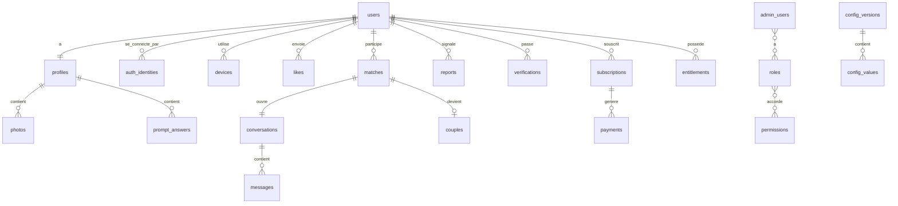

# Joga — Modèle de données (brouillon v0.1)

> Statut : **brouillon à valider**. Dix décisions ont été prises le 2026-11-10 (§16). Migrations écrites et testées pour les étapes 1 (comptes, admin, configuration), 2 (profil, référentiels, photos), 3 (vérification, modération), 4 (découverte, likes, matchs), 5 (chat, notifications), 6 (business) et 7 (couple, liste d'attente, contenu) : le schéma initial est complet.
> Lire avec `PERIMETRE.md` (§7), `ADMIN-SCOPE.md` (rôles, configuration), `BUSINESS.md` (offres, droits, paiements) et `GUIDELINES.md` (règles non négociables).
> Base : PostgreSQL 16 + PostGIS. Les noms de tables et de colonnes sont en anglais, comme le code.

## 1. Principes

1. **Identifiants opaques** : UUID (version 7, générés par l'application, bons pour l'ordre d'insertion). Jamais d'identifiant incrémental exposé.
2. **Dates en `timestamptz`**, stockées en UTC.
3. **`gender` et `looking_for` séparés** (valeurs `male`, `female` en v1, extensibles).
4. **Référentiels modifiables depuis l'admin** (communes, religions, langues, questions, motifs…) : tables de référence avec libellés par langue (`jsonb`), jamais d'énumérations figées dans la base pour ce qui peut évoluer.
5. **Configuration, pas du code** : quotas, poids, seuils sont dans les tables de configuration (§10).
6. **Données sensibles minimales** : le numéro de téléphone est chiffré et dédoublonné par empreinte ; les selfies ne sont jamais conservés après décision ; pas de gabarit biométrique.
7. **Suppression propre** : chaque table a une règle de suppression (§14). Une suppression de compte est un processus, pas un simple `DELETE`.
8. **Tout est traçable** : les actions de l'admin et les accès sensibles passent par le journal d'audit non modifiable.
9. **Idempotence** : les opérations rejouables (like, message, webhook de paiement) portent une clé d'idempotence unique.
10. **Partitionnement mensuel** prévu pour les tables à fort volume : `messages`, `impressions`, `audit_log`, `outbox_events`.

## 2. Vue d'ensemble

## 3. Domaine A : comptes et connexion

| Table | Colonnes clés | Contraintes et index |
|---|---|---|
| `users` | `id`, `status` (`pending`, `active`, `paused`, `suspended`, `banned`, `deletion_pending`, `deleted`), `phone_encrypted`, `phone_hash`, `date_of_birth`, `locale`, `created_at`, `last_active_at`, `deletion_requested_at`, `deletion_effective_at` | `phone_hash` unique (empreinte avec clé secrète) ; âge minimum 18 vérifié à l'inscription ; index sur `status` |
| `auth_identities` | `id`, `user_id`, `provider` (`phone`, `apple`, `google`), `provider_subject`, `verified_at` | unique (`provider`, `provider_subject`) |
| `otp_challenges` | `id`, `phone_hash`, `channel` (`whatsapp`, `sms`), `code_hash`, `attempts`, `expires_at`, `consumed_at`, `ip_hash`, `device_id` | index (`phone_hash`, `created_at`) pour la limitation de débit ; purge sous 24 h |
| `devices` | `id`, `user_id`, `platform`, `app_version`, `push_token`, `fingerprint_hash`, `last_seen_at` | index `user_id` ; détection de comptes multiples par `fingerprint_hash` |
| `refresh_tokens` | `id`, `user_id`, `device_id`, `token_hash`, `rotated_from`, `expires_at`, `revoked_at` | rotation à chaque usage ; unique `token_hash` |
| `consents` | `id`, `user_id`, `type` (`terms`, `privacy`, `religion`, `verification`, `billing`), `version`, `granted_at`, `revoked_at` | preuve de consentement exigée par le Code du numérique |

Note : la **date de naissance exacte** est stockée (donnée sensible). Ce qui s'affiche est limité par le choix de la personne (`profiles.birthday_display`).

## 4. Domaine B : profil

| Table | Colonnes clés | Contraintes et index |
|---|---|---|
| `profiles` | `user_id` (clé), `first_name`, `gender`, `looking_for`, `commune_id`, `birthday_display` (`age_only` ou `day_month` : âge seul, ou âge avec jour et mois d'anniversaire), `height_cm`, `job`, `education_code`, `children_status_code`, `children_wish_code`, `dating_intention_code`, `relationship_type_code`, `religion_code`, `drinking_code`, `smoking_code`, `cannabis_code`, `drugs_code`, `hometown`, `field_visibility` (`jsonb` : champ → affiché ou masqué), `completeness`, `status` (`draft`, `pending_review`, `visible`, `hidden`), `verified_at` | index de découverte (`status`, `gender`, `looking_for`, `commune_id`) ; **aucune position précise n'est stockée** : seule la commune ; codes = clés vers `ref_values` |
| `profile_languages` | `user_id`, `language_code` | clé (`user_id`, `language_code`) |
| `photos` | `id`, `user_id`, `position` (1 à 6), `storage_key`, `width`, `height`, `blurhash`, `status` (`uploaded`, `processing`, `approved`, `rejected`, `removed`), `moderation_scores` (`jsonb`), `rejection_reason_code`, `perceptual_hash`, `created_at` | unique (`user_id`, `position`) pour les photos actives ; index `perceptual_hash` (doublons) |
| `prompt_answers` | `id`, `user_id`, `prompt_id`, `position` (1 à 3), `answer_text` (225 caractères max), `status` | unique (`user_id`, `position`) ; contrainte de longueur |
| `preferences` | `user_id`, `age_min`, `age_max`, `max_distance_km`, `commune_ids`, `advanced_filters` (`jsonb`) | bornes validées par la configuration |

Règles : un profil n'est `visible` que si les photos minimales sont `approved` et que les règles de la configuration sont respectées. Quand un couple est actif (§13), les deux profils sont retirés de la découverte (mis en pause) et reviennent si le couple prend fin.

## 5. Domaine C : référentiels et géographie

| Table | Colonnes clés | Notes |
|---|---|---|
| `ref_values` | `id`, `kind` (`religion`, `education`, `language`, `intention`, `children_status`, `children_wish`, `relationship_type`, `drinking`, `smoking`, `cannabis`, `drugs`, `report_reason`, `photo_rejection_reason`, `selfie_gesture`, …), `code`, `labels` (`jsonb` par langue), `position`, `active` | unique (`kind`, `code`) ; géré depuis l'admin, avec versions de configuration |
| `ref_prompts` | `id`, `code`, `texts` (`jsonb` par langue), `position`, `active` | au moins 30 au lancement |
| `cities` | `id`, `code`, `name`, `status` (`closed`, `waitlist`, `open`), `centroid` | ouverture par ville depuis l'admin |
| `communes` | `id`, `city_id`, `name`, `centroid`, `boundary` (polygone, optionnel) | la distance se calcule entre les centres des communes ; Kinshasa : ses communes |

## 6. Domaine D : découverte, likes, matchs

| Table | Colonnes clés | Contraintes et index |
|---|---|---|
| `daily_batches` | `id`, `user_id`, `batch_date`, `config_version_id`, `algorithm_version`, `generated_at` | unique (`user_id`, `batch_date`) ; garde la version de configuration utilisée |
| `daily_batch_items` | `batch_id`, `candidate_user_id`, `position`, `score`, `reasons` (`jsonb`), `is_daily_pick` | clé (`batch_id`, `position`) |
| `impressions` | `id`, `viewer_id`, `target_id`, `batch_id`, `shown_at` | partitionnée par mois ; sert à l'apprentissage futur |
| `likes` | `id`, `from_user_id`, `to_user_id`, `target_type` (`photo`, `prompt_answer`, `profile`), `target_id`, `comment` (500 caractères max), `status` (`pending`, `matched`, `declined`), `idempotency_key`, `created_at` | **un seul like par personne** : unique (`from_user_id`, `to_user_id`) ; unique `idempotency_key` ; index (`to_user_id`, `status`) pour « Likes reçus » |
| `passes` | `from_user_id`, `to_user_id`, `created_at` | clé (`from_user_id`, `to_user_id`) |
| `matches` | `id`, `user_a_id`, `user_b_id` (ordre fixe : a < b), `source_like_id`, `status` (`active`, `unmatched`), `unmatched_by`, `created_at`, `unmatched_at` | unique (`user_a_id`, `user_b_id`) |
| `blocks` | `blocker_id`, `blocked_id`, `reason_code`, `created_at` | clé (`blocker_id`, `blocked_id`) ; exclu des lots dans les deux sens |
| `like_usage` | `user_id`, `day`, `count` | quota du jour ; le décompte chaud est dans Redis, cette table est la source de vérité |

## 7. Domaine E : chat

| Table | Colonnes clés | Contraintes et index |
|---|---|---|
| `conversations` | `id`, `match_id`, `created_at`, `last_message_at` | unique `match_id` |
| `conversation_participants` | `conversation_id`, `user_id`, `last_delivered_message_id`, `last_read_message_id`, `muted` | « envoyé / distribué / lu » se déduit de ces curseurs : pas de ligne par message et par lecteur |
| `messages` | `id`, `conversation_id`, `sender_id`, `body`, `client_message_id`, `warning_flags` (`jsonb`), `created_at` | partitionnée par mois ; unique (`sender_id`, `client_message_id`) pour l'idempotence ; index (`conversation_id`, `id`) |

`warning_flags` porte les signaux anti-arnaque (lien, numéro, demande d'argent trop tôt). Le contenu des messages n'est lisible côté admin que dans l'extrait copié dans un signalement.

## 8. Domaine F : sécurité, modération, vérification

| Table | Colonnes clés | Contraintes et index |
|---|---|---|
| `reports` | `id`, `reporter_id`, `reported_user_id`, `target_type` (`profile`, `photo`, `message`), `target_id`, `reason_code`, `details`, `status` (`open`, `in_review`, `closed`), `priority`, `assigned_admin_id`, `resolution_code`, `created_at`, `resolved_at` | index (`status`, `priority`, `created_at`) |
| `report_snapshots` | `report_id`, `snapshot` (`jsonb`) | extrait du message ± 2 messages, ou de la photo concernée ; purge selon la rétention |
| `moderation_actions` | `id`, `user_id`, `admin_user_id`, `action` (`warn`, `suspend`, `unsuspend`, `ban`, `photo_reject`, `profile_hide`), `reason_code`, `note`, `starts_at`, `ends_at`, `report_id`, `approval_id` | `approval_id` renseigné quand un second avis est exigé |
| `appeals` | `id`, `user_id`, `moderation_action_id`, `text`, `status`, `decided_by`, `decided_at` | |
| `verifications` | `id`, `user_id`, `provider` (`manual`, `aws`), `challenge_code`, `status` (`pending`, `needs_review`, `approved`, `rejected`, `expired`), `precheck` (`jsonb`), `reviewed_by`, `reviewed_at`, `rejection_reason_code`, `evidence_storage_key`, `purge_after`, `created_at` | `evidence_storage_key` mis à `NULL` et fichier supprimé à la décision, 7 jours au plus (`purge_after`) |
| `data_requests` | `id`, `user_id`, `type` (`export`, `deletion`), `status`, `requested_at`, `completed_at` | alimente la file « Demandes de données » de l'admin |

## 9. Domaine G : notifications

| Table | Colonnes clés | Notes |
|---|---|---|
| `notification_preferences` | `user_id`, `category` (`likes`, `matches`, `messages`, `reminders`), `push_enabled` | clé (`user_id`, `category`) |
| `notifications` | `id`, `user_id`, `type`, `payload` (`jsonb`), `channel`, `sent_at`, `read_at` | rétention courte (par exemple 30 jours) |
| `message_templates` | `id`, `code`, `channel`, `texts` (`jsonb` par langue), `active` | gabarits de notifications, SMS, WhatsApp, e-mails (gérés depuis l'admin) |

Les jetons de notification sont dans `devices`.

## 10. Domaine H : configuration

| Table | Colonnes clés | Notes |
|---|---|---|
| `config_definitions` | `key` (clé), `category`, `value_type` (`int`, `number`, `bool`, `string`, `enum`, `list`, `json`), `default_value`, `constraints` (`jsonb` : min, max, valeurs permises), `description`, `allowed_scopes`, `sensitive`, `requires_approval` | ajouter un paramètre = ajouter une ligne ; l'admin génère le formulaire |
| `config_versions` | `id`, `number`, `status` (`draft`, `scheduled`, `published`, `rolled_back`), `reason`, `effective_at`, `created_by`, `published_by`, `approval_id`, `created_at`, `published_at` | une seule version `published` active à un instant donné |
| `config_values` | `version_id`, `key`, `scope_type` (`global`, `city`, `platform`, `app_version`, `segment`), `scope_value`, `value` (`jsonb`) | unique (`version_id`, `key`, `scope_type`, `scope_value`) ; les drapeaux de fonctionnalité sont des valeurs avec pourcentage de déploiement |
| `config_state` | `current_version_id`, `updated_at` | pointeur unique vers la version en vigueur |

Les garde-fous de sécurité (âge minimum 18 ans, suppression des selfies) ne sont **pas** dans ces tables.

## 11. Domaine I : administration

| Table | Colonnes clés | Contraintes et index |
|---|---|---|
| `admin_users` | `id`, `email` (insensible à la casse), `full_name`, `status` (`invited`, `active`, `disabled`), `totp_secret_encrypted`, `last_login_at`, `created_by`, `created_at` | unique `email` |
| `admin_invitations` | `id`, `email`, `role_id`, `token_hash`, `expires_at`, `accepted_at`, `invited_by` | lien à durée limitée ; pas d'inscription libre |
| `webauthn_credentials` | `id`, `admin_user_id`, `credential_id`, `public_key`, `counter`, `created_at` | clés d'accès |
| `roles` | `id`, `code`, `name`, `is_system` | les 8 rôles validés, plus personnalisables plus tard |
| `permissions` | `id`, `resource`, `action` | par exemple `reports` + `act` |
| `role_permissions` | `role_id`, `permission_id`, `requires_second_approval` | traduit la matrice de `ADMIN-SCOPE.md` |
| `admin_user_roles` | `admin_user_id`, `role_id` | |
| `admin_sessions` | `id`, `admin_user_id`, `token_hash`, `ip_hash`, `user_agent`, `expires_at`, `revoked_at` | sessions courtes |
| `approvals` | `id`, `action_type`, `payload` (`jsonb`), `requested_by`, `approved_by`, `status` (`pending`, `approved`, `rejected`, `expired`), `requested_at`, `decided_at` | second avis : la personne qui approuve ne peut pas être celle qui demande |
| `audit_log` | `id`, `occurred_at`, `actor_type` (`admin`, `system`), `actor_admin_id`, `action`, `target_type`, `target_id`, `reason`, `before` (`jsonb`), `after` (`jsonb`), `ip_hash` | **en ajout seul** : droits de modification et de suppression retirés ; partitionnée par mois ; trace aussi les accès sensibles (numéro révélé, photo révélée) |

## 12. Domaine J : business

| Table | Colonnes clés | Notes |
|---|---|---|
| `products` | `id`, `code` (par exemple `joga_plus`), `type` (`subscription`, `pass`), `active` | |
| `prices` | `id`, `product_id`, `currency` (`USD`, `CDF`), `amount_minor`, `period_days`, `city_id`, `store_product_ids` (`jsonb` : identifiants Apple et Google), `active_from`, `active_to` | catalogue géré depuis l'admin |
| `product_entitlements` | `product_id`, `entitlement_code`, `params` (`jsonb`) | par exemple `likes_per_day`, `see_likes`, `advanced_filters` |
| `entitlements` | `id`, `user_id`, `code`, `params`, `source` (`subscription`, `grant`, `promo`), `subscription_id`, `starts_at`, `ends_at` | **seule table lue par l'app** pour savoir ce qu'une personne a le droit de faire ; indépendante du moyen de paiement |
| `subscriptions` | `id`, `user_id`, `product_id`, `provider` (`apple`, `google`, `pawapay`, `manual`), `provider_subscription_id`, `status` (`active`, `grace`, `expired`, `canceled`, `refunded`), `current_period_start`, `current_period_end`, `auto_renew`, `created_at` | unique (`provider`, `provider_subscription_id`) |
| `payments` | `id`, `user_id`, `subscription_id`, `provider`, `provider_payment_id`, `amount_minor`, `currency`, `fee_minor`, `status`, `idempotency_key`, `raw` (`jsonb`, données personnelles retirées), `created_at`, `settled_at` | unique (`provider`, `provider_payment_id`) |
| `refunds` | `id`, `payment_id`, `amount_minor`, `reason`, `status`, `requested_by`, `approval_id`, `created_at` | second avis exigé |
| `payment_webhook_events` | `id`, `provider`, `event_id`, `payload`, `received_at`, `processed_at` | unique (`provider`, `event_id`) : un webhook traité deux fois ne change rien |

## 13. Domaines K à M : liste d'attente, contenu, couple

| Table | Colonnes clés | Notes |
|---|---|---|
| `waitlist_entries` | `id`, `contact_encrypted`, `contact_hash`, `contact_type` (`phone`, `email`), `city_id`, `consent_at`, `source`, `notified_at`, `unsubscribed_at` | unique `contact_hash` ; alimentée par le site via l'API |
| `content_items` | `id`, `type` (`blog`, `safety_tip`, `announcement`), `slug`, `title` et `body` (`jsonb` par langue), `status`, `published_at`, `author_admin_id` | gérés depuis l'admin |
| `couples` | `id`, `user_a_id`, `user_b_id`, `match_id`, `status` (`pending`, `active`, `ended`), `confirmed_a_at`, `confirmed_b_at`, `started_at`, `ended_at`, `ended_by` | **utilisée dès la v1** pour « Nous sommes en couple » : les deux personnes confirment d'un commun accord (`pending` puis `active`), les profils sont alors mis en pause ; chacune peut y mettre fin seule |
| `couple_games` | `id`, `couple_id`, `game_code`, `state` (`jsonb`), `turn_user_id`, `updated_at` | **plus tard** ; jeux au tour par tour |

Technique : `outbox_events` existe déjà (migration initiale) ; une table `idempotency_keys` pourra servir aux opérations non couvertes ci-dessus.

## 14. Rétention et suppression de compte

Suppression demandée : le compte passe à `deletion_pending` (délai de grâce de **14 jours** par défaut, réglable par la configuration : `account_deletion_grace_days`), puis une tâche exécute la suppression.

| Donnée | Règle |
|---|---|
| Profil, réponses, préférences, appareils, jetons | supprimés |
| Photos (base et fichiers Google Cloud Storage) | supprimées |
| Selfies de vérification | supprimés à la décision, 7 jours au plus ; jamais conservés après |
| Messages envoyés | supprimés (ou rendus anonymes si un signalement est en cours) |
| Likes, passes, matchs, conversations | supprimés pour la personne ; la conversation disparaît pour l'autre côté |
| Signalements la concernant | conservés sans données personnelles, durée légale à définir |
| Paiements et abonnements | conservés pour la comptabilité, rendus anonymes (lien vers l'identité coupé) |
| `audit_log` | conservé (références opaques) |
| Numéro de téléphone | supprimé ; on garde l'empreinte seulement pendant la durée de blocage utile contre les abus, à définir |
| Consentements | conservés (preuve) sous forme minimale |

## 15. Index et performances (à retenir)

- Découverte : index composite sur les profils visibles (`gender`, `looking_for`, `commune_id`) ; la distance se calcule entre communes ; le lot du jour est précalculé de nuit.
- « Likes reçus » : index (`to_user_id`, `status`).
- Chat : lecture par (`conversation_id`, `id`) décroissant, partition mensuelle.
- Limitation de débit des codes : index sur `otp_challenges`.
- Partitions mensuelles créées par une tâche planifiée.

## 16. Décisions et questions ouvertes

### Décisions prises (2026-11-10)

1. **Date de naissance** : la date exacte est stockée. L'affichage est au choix de la personne : âge seul, ou âge avec jour et mois d'anniversaire.
2. **Délai de grâce avant suppression définitive** : 14 jours (valeur par défaut, réglable).
3. **Localisation** : commune seulement. Aucune position précise n'est stockée ; la distance se calcule entre communes.
4. **« Nous sommes en couple » dès la v1** : décision d'un commun accord, les deux personnes confirment. Les deux profils sont alors mis en pause. Chacune peut mettre fin au couple seule.
5. **Un seul like par personne.**

5. **Messages après un « unmatch » ou une rupture** : supprimés pour les deux côtés après 30 jours, sauf si un signalement est en cours (`messages_retention_after_unmatch_days`).
6. **Changement de numéro** : autonome, avec le nouveau numéro seul vérifié par code. Risque de prise de contrôle accepté ; atténuations : délai entre deux changements (`phone_change_cooldown_days`), notification des anciens appareils, journal `phone_change_events`.
7. **Partitionnement dès le départ** pour toutes les tables à fort volume : `messages`, `impressions`, `audit_log`, `outbox_events` (fonction `ensure_monthly_partitions`, à planifier chaque mois).
8. **Signalements clos et extraits** : conservés 12 mois (`reports_retention_months`), à valider avec un juriste.
9. **Chiffrement du numéro** : au niveau de l'application, clé gérée hors de la base ; unicité par empreinte HMAC.
10. **Appareils** : 3 actifs par compte, le plus ancien est déconnecté au-delà (`max_active_devices_per_account`).

### Questions encore ouvertes

Aucune. Le schéma initial (étapes 1 à 7) est écrit et testé dans le repo `backend`. Reste à valider par un juriste les durées de conservation (§14).

## 17. Ordre de mise en œuvre proposé

1. Comptes, connexion, consentements, configuration, rôles de l'admin (fondations).
2. Profil, référentiels, photos.
3. Vérifications et modération.
4. Découverte, likes, matchs.
5. Chat, notifications.
6. Business : produits, droits, abonnements, paiements.
7. Couple (tables créées tôt, usage plus tard).

Étapes 1 à 7 : faites (schéma initial complet) (backend, `migrations/`). Notes de l'étape 2 : centres des communes à renseigner depuis l'admin avant le calcul de distance ; liste des 30 prompts à rédiger ; référentiels semés en français seulement (lingala et anglais à compléter).

Notes de l'étape 3 : bannir exige un second avis (contrainte en base) ; les sanctions sont en ajout seul et s'anonymisent à la suppression du compte ; le selfie ne peut pas dépasser 7 jours ni survivre à la décision (contraintes en base) ; quatre paramètres de modération ajoutés à la configuration.

Notes de l'étape 4 : un like par paire et une ligne de match par paire (ordre a < b) imposés en base ; impressions partitionnées par mois ; `couples` reste prévue avec l'étape 7.

Notes de l'étape 5 : l'unicité (expéditeur, client_message_id) ne peut pas vivre sur la table partitionnée `messages` ; elle est portée par la table `message_client_ids`, écrite dans la même transaction. Seul un participant peut écrire (contrainte en base). Les gabarits de messages ne sont pas semés : textes à rédiger.

Notes de l'étape 6 : Joga+ est préparé mais inactif, sans prix ni devise (décisions business ouvertes) et le drapeau `feature_joga_plus_enabled` est coupé ; aucun droit ne peut porter sur la sécurité (vérification, signalement, blocage, suppression, export : contrainte en base) ; paiements et abonnements s'anonymisent à la suppression du compte ; un remboursement validé exige un second avis.

Notes de l'étape 7 : un match ne porte qu'une demande ou un couple en cours ; une personne ne peut être que dans un couple actif à la fois (déclencheur en base) ; l'activation exige les deux confirmations ; la mise en pause des profils est faite par l'application ; la liste d'attente exige un consentement daté ; `couple_games` est préparée, non utilisée en v1.

Notes de l'étape 8 (prompts) : 30 questions semées en français seulement (brouillon à relire ; lingala et anglais à compléter) ; une question ne sert qu'une fois par personne (contrainte en base) ; le profil n'est `visible` qu'avec `prompts_required` réponses (3 par défaut, configuration) en plus des photos ; longueur min et max lues de la configuration.

Notes de l'étape 9 (découverte) : le lot du jour est composé à la première demande de la journée (jour de Kinshasa), pas encore par un worker de nuit ; filtres éliminatoires (genre croisé, tranches d'âge des deux côtés, jamais aimé, passé, bloqué ni en match, profil visible), score pondéré avec les poids `match_weight_*` de la configuration (la réciprocité se limite pour l'instant à « m'a déjà aimé » et la proximité à la même commune, les centres des communes n'étant pas renseignés), plafond d'exposition par jour, assouplissement progressif (commune, puis profils déjà présentés) pour ne pas servir un lot vide ; le profil complet n'est accessible que pour un membre d'un lot des 3 derniers jours ou ayant aimé la personne ; un champ est masqué quand `field_visibility[clé]` vaut `false` (clé = colonne sans `_code` ni `_cm`).

Notes de l'étape 10 (likes et matchs) : un like porte sur une photo, une réponse de prompt ou le profil, avec un commentaire facultatif (longueur max `like_comment_max_length`) ; le quota du jour (`likes_per_day`, jour de Kinshasa) est consommé dans la même transaction que le like, donc une demande refusée ne coûte rien ; la clé d'idempotence est préfixée par l'identifiant de la personne ; un verrou par paire de personnes garantit qu'un like simultané ne crée qu'un seul match ; un like réciproque crée le match (ordre a < b), la conversation, ses deux participants et les événements `LikeCreated` et `MatchCreated` ; « Passer » sur un like reçu le passe à `declined` ; les likes reçus excluent les personnes bloquées ou déjà passées. Le quota lit pour l'instant la configuration seule ; les droits (`entitlements`) s'y brancheront avec Joga+.

Chaque étape donne une migration relue, avec son plan de retour arrière.

Notes de l'étape 11 (chat) : l'envoi est idempotent par (expéditeur, `client_message_id`) via `message_client_ids` ; « envoyé / distribué / lu » se déduit des curseurs des participants (monotones, jamais de recul) ; les signaux anti-arnaque (lien, numéro, demande d'argent, `early` si l'expéditeur a envoyé moins de `scam_early_message_count` messages) sont écrits dans `warning_flags` sans jamais bloquer l'envoi ; une conversation fermée (unmatch, couple en pause) refuse l'écriture (`CONVERSATION_CLOSED`) ; la passerelle temps réel (Socket.IO, jeton d'accès dans `auth.token`) relaie les événements publiés sur Redis (`chat:user:<id>`) ; côté app, les messages en attente sont conservés sur l'appareil et partent au retour du réseau (« Envoi en attente »).
